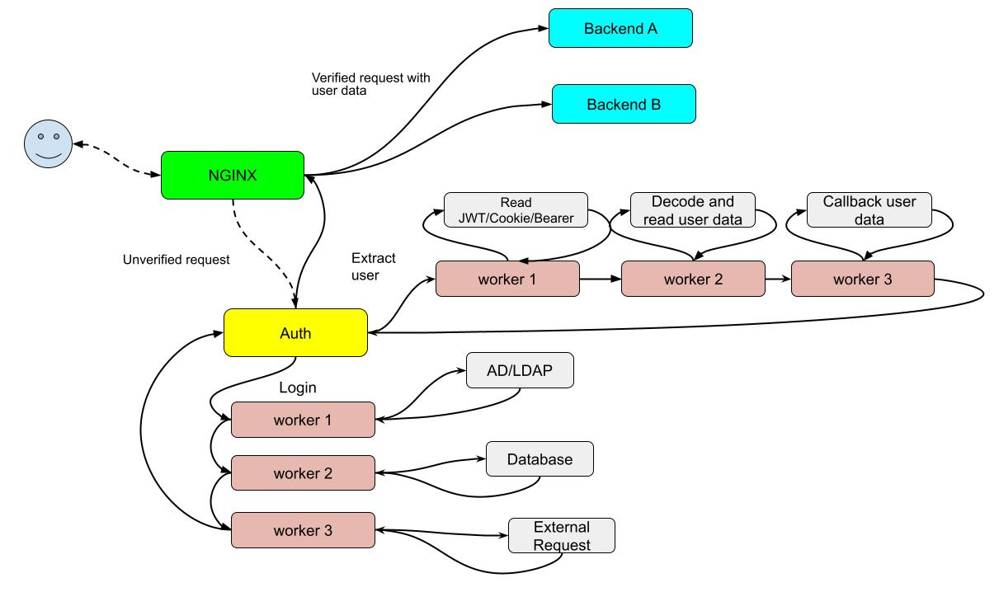

# @reneos/auth

An intermediate microservice for authentication and authorization, optimized for microservices architecture. Implements a **declarative pipeline** model — each HTTP route is a chain of small worker modules executed in sequence.

Works without any external dependencies — uses only the built-in Node.js `http` module.

> Article in Russian: https://habr.com/ru/post/591319/

---

## Requirements

- Node.js >= 20.18.0

---

## Installation

```bash
npm i @reneos/auth
```

---

## Quick Start

```javascript
import { App } from "@reneos/auth"
import Config from "./config.js"

App.Start(Config)
```

See `./examples/` for a full working setup.

---

## How It Works

Each route is defined as an **ordered list of workers**. When a request comes in, the workers execute one by one. The output of each worker becomes the input (`data`) of the next. If any worker returns `null` or `undefined`, the chain stops and the response is finalized immediately.

```
Request → [worker1] → [worker2] → ... → [workerN] → Response
```



---

## Configuration Structure

The configuration passed to `App.Start` has two sections:

```javascript
{
  web: {
    port: 5000,       // HTTP port (default: 5000)
    maxdata: 1024000  // Max request body size in bytes (default: 1 MB)
  },
  app: {
    configs: [
      {
        routes: [
          {
            path: "/some/path",
            workers: [
              { name: "workerName", options: { /* worker-specific options */ } }
            ]
          }
        ]
      }
    ]
  }
}
```

Multiple config objects can be merged in `configs` — useful for splitting auth routes and API routes into separate files.

---

## Built-in Workers

All built-in workers are located in `src/workers/`. They are available by name in the configuration without any additional imports.

### `reqprops`
Extracts a nested property from the `req` object and passes it as the next `data`.

```javascript
{ name: "reqprops", options: { properties: ["body"] } }
// Extracts req.body

{ name: "reqprops", options: { properties: ["cookie", "auth"] } }
// Extracts req.cookie.auth
```

---

### `req`
Makes an HTTP POST request to an external service (e.g. a JWT service or auth backend). Merges `options.data` with the current `data` before sending.

```javascript
{
  name: "req",
  options: {
    url: "localhost",
    port: 22001,
    path: "/encode",
    data: { secret: "jwt_secret", expire: "240h" }
  }
}
```

Use `options.field` to extract a specific field from the response.

---

### `extget`
If the current `data` is a **string** (e.g. a raw token), sends it to an external service for verification. If `data` is already an object, passes it through unchanged.

```javascript
{
  name: "extget",
  options: { url: "localhost", port: 20110, path: "/auth" }
}
```

---

### `fieldsexists`
Checks that all specified fields exist in `data`. If any field is missing, responds with `{}` (or the full `data` if `returnresult: true`) and stops the chain.

```javascript
{
  name: "fieldsexists",
  options: { fields: ["id"], returnresult: false }
}
```

---

### `inlist`
Checks that `data[field]` is present in the allowed list. If not, responds with `{}` and stops the chain.

```javascript
{
  name: "inlist",
  options: { field: "id", list: ["user1", "admin"] }
}
```

---

### `setdata`
Saves `data` into the in-memory session store (`Data`) using `data[field]` as the key. Returns `{ id }`.

```javascript
{ name: "setdata", options: { field: "id" } }
```

---

### `getdata`
Reads a previously saved session from the store by `data[field]` as the key. Returns the stored object.

```javascript
{ name: "getdata", options: { field: "id" } }
```

---

### `setcookie`
Sets a `Set-Cookie` response header using the current `data` as the value. Returns `{ result: true }`.

```javascript
{
  name: "setcookie",
  options: {
    name: "auth",
    mix: {
      httpOnly: true,
      path: "/",
      duration: 864000  // seconds
    }
  }
}
```

---

### `sethead`
Serializes `data` into a response header (stripping unsafe characters), writes it, and ends the response. Returns `null` — always terminates the chain.

```javascript
{ name: "sethead", options: { header: "X-User" } }
```

> This is the key worker for **nginx `auth_request`** integration: the reverse proxy reads the `X-User` header after a successful auth check.

---

### `getprop`
Extracts `data[property]` and returns it as the next `data`.

```javascript
{ name: "getprop", options: { property: "token" } }
```

---

## Custom Worker Modules

You can inject your own workers by passing them as the second argument to `App.Start`:

```javascript
import { App } from "@reneos/auth"
import MyModule from "./mymods/mymodule.js"
import Config from "./config.js"

App.Start(Config, {
  "mymodule": MyModule
})
```

A custom worker must export a default function with the following signature:

```javascript
export default async function (options, data, req, res) {
  // options — configuration object from the route definition
  // data    — output of the previous worker (or {} for the first)
  // req     — Node.js IncomingMessage
  // res     — Node.js ServerResponse

  return { ...data, extra: true } // return value becomes next data
}
```

**Rules:**
- Return an object/string/value → passed to the next worker.
- Return `null` or `undefined` → chain stops, `204 No Content` is sent (unless `res` was already used).
- Throw an error with `error.code` → response with that HTTP status code and `error.message`.
- All other thrown errors → `500 Internal Server Error` + `errorchain` event.

---

## Common Auth Flows

### `/auth/login`

```
reqprops(body) → req(auth backend: verify credentials) → fieldsexists([id])
  → setdata(id) → req(JWT service: encode) → setcookie(auth)
```

### `/auth` — session check (for nginx `auth_request`)

```
reqprops(cookie.auth) → req(JWT service: decode) → getdata(id)
  → extget(auth backend: verify) → fieldsexists([id]) → sethead(X-User)
```

### `/auth/logout`

```
reqprops(cookie.auth) → req(JWT service: decode) → req(auth backend: logout)
  → sethead(X-User)
```

---

## API / Exported Classes

### `App`
```javascript
App.Start(config, mods?)
```
Starts both the worker pipeline and the HTTP server.

---

### `Server`
```javascript
Server.Start(config)          // Start HTTP server
Server.AddRoute(path, fn)     // Register a route handler
Server.RemoveRoute(path)      // Unregister a route
Server.Destroy()              // Gracefully stop the server
Server.Port                   // Current port
Server.on('error', fn)        // Listen for server errors
```

---

### `Worker`
```javascript
Worker.Start(config, mods)        // Build and register all pipelines
Worker.on('ready', fn)            // All routes registered
Worker.on('errorchain', fn)       // Error in a worker chain
Worker.on('endchain', fn)         // Chain ended without a value
```

---

### `Data`
In-memory session store with automatic TTL expiration.

```javascript
Data.SetData(key, values, expires?)  // Store data (default TTL: 86400000 ms = 24h)
Data.GetData(key)                    // Retrieve data by key
Data.RemoveData(key)                 // Remove entry and cancel timeout
Data.ClearAll()                      // Wipe all stored data
```

---

## Environment Variables (example config)

| Variable | Default | Description |
|---|---|---|
| `JWT_SECRET` | `jwt_secret` | JWT signing secret |
| `JWT_PORT` | `22001` | JWT service port |
| `JWT_ENCODEPATH` | `/encode` | JWT encode endpoint |
| `JWT_DECODEPATH` | `/decode` | JWT decode endpoint |
| `JWT_EXPIRE` | `240h` | Token expiration |
| `EXT_HOST` | `localhost` | External auth service host |
| `EXT_PORT` | `20110` | External auth service port |
| `EXT_LOGIN` | `/auth/login` | Login endpoint on auth backend |
| `EXT_AUTH` | `/auth` | Verify endpoint on auth backend |
| `EXT_LOGOUT` | `/auth/logout` | Logout endpoint on auth backend |
| `TOKENCOOKIE` | `auth` | Cookie name for the auth token |

---

## Events

| Event | Emitter | Description |
|---|---|---|
| `ready` | `Worker` | All routes have been successfully registered |
| `errorchain` | `Worker` | An error occurred inside a worker in a chain |
| `endchain` | `Worker` | A worker returned `null`/`undefined`, chain stopped |
| `error` | `Server` | An unhandled error occurred during request processing |

---

## License

MIT © Viktor Abdulov
